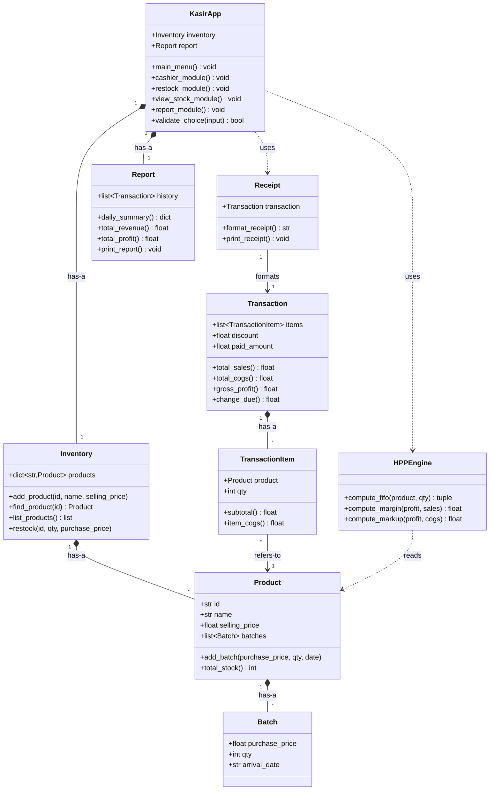

# KasirFIFO-FirtsInFirstOut-CPro2
Project Intro to Computer Programming - Team 3

## 👥 Tim Kami
| Prima Aditama  | Inventaris (`inventory.py`) |
| Bachtiar Arief N | Engine HPP FIFO (`cogs.py`) |
| Andra Putra P | Kasir POS (`pos.py`) |
| Wisam Ikbar D | Laporan, CLI, Unit Test (`main.py`, `report.py`) |

## 📐 Class Diagram

